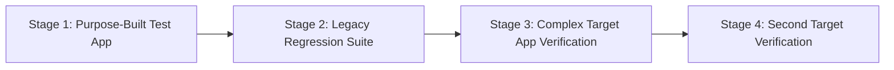
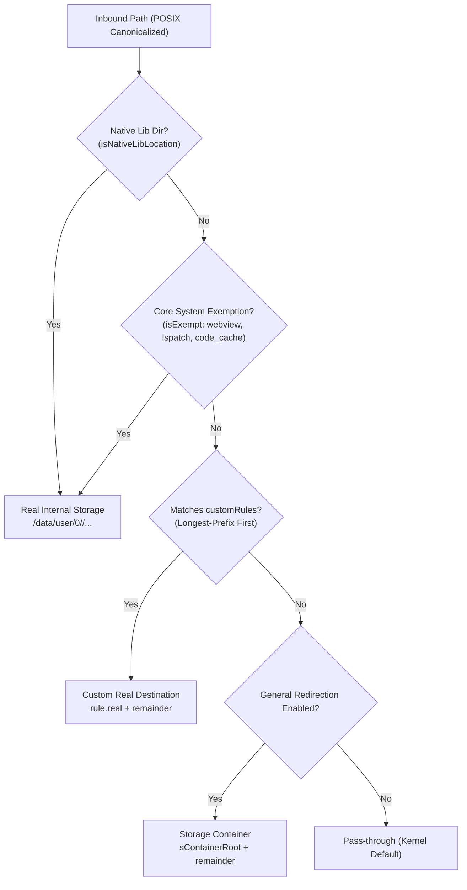

# LSPatch Storage Redirection: Path Spoofing Architecture & Design Specification

**Document Version:** 2.2  
**Target Project:** LSPatch-Zero-Bloat (`org.lsposed.lspatch`)  
**Status:** Design Proposal (Awaiting Approval)  
**Classification:** Internal Technical Architecture Specification (Do Not Commit)

---

## 1. Executive Summary & Core Objective

The objective of Path Spoofing is to evolve LSPatch's storage redirection from **direct path rewriting** into **transparent path virtualization (path spoofing)**:
- **Application Perception:** The target application consistently sees and queries standard Android canonical paths (`/data/user/0/<pkg>/...`, `/data/data/<pkg>/...`, `/storage/emulated/0/Android/data/<pkg>/...`, `/sdcard/...`, databases, shared preferences, cache, code_cache). Calls to `File.getPath()`, `File.getAbsolutePath()`, `File.getCanonicalPath()`, `Context.getFilesDir()`, `SQLiteDatabase.getPath()`, and directory listings will NEVER reveal the real container location.
- **Physical I/O Execution:** All underlying filesystem I/O operations are transparently dispatched to the user-configured storage container (e.g. `/storage/emulated/0/.fnrod/...`).
- **Core Security & Execution Invariants:**
  - Native shared libraries (`.so` files, ELF binaries, SoLoader extraction directories) are strictly exempted at the **directory level** and retained in real app-private storage (`0755` permissions) to satisfy Android linker namespace constraints (`clns-*`).
  - Xposed module discovery, signature bypass, zero-bloat packaging, and re-patching remain 100% unaffected.
  - The existing direct-redirection behavior is preserved as a user-selectable legacy fallback mode.

---

## 2. Implementation Ordering: Native libc Translation First, Then Java Spoofing

### 2.1 The Critical Ordering Rationale
Development and verification MUST follow a strict two-stage sequence:
1. **Stage 1 (First): Native libc Syscall & POSIX Translation:**
   Implement, test, and prove path translation at the native level via PLT hooking (`open`, `openat` with `dirfd`, `stat`, `fstatat`, `access`, `faccessat`, `unlink`, `unlinkat`, `rename`, `renameat`, `mkdir`, `mkdirat`, `opendir`, `readdir`, `readlink`, `readlinkat`, `realpath`, `chdir`, `chmod`, `statfs`), proven by tests before touching Java objects.
2. **Stage 2 (Second): Java Object Spoofing:**
   Implement Java-layer spoofing (`ContextImpl` getters returning virtual paths, `File` object path retention, `File.list()` / `File.listFiles()` reverse-mapping wrappers, exception message sanitization).

### 2.2 Why `libcore.io.Os` Hooks Cannot Cover SQLite and `File.list`
A common architectural pitfall is attempting to handle path virtualization solely at the Java `libcore.io.Os` boundary. This is fundamentally insufficient for two critical Android subsystems:

#### A. SQLite Architecture Bypasses Java `libcore.io.Os` Entirely
- In Android (`android.database.sqlite.*`), database management is a thin Java wrapper around native `libsqlite.so` and `libandroid_runtime.so` (`android_database_SQLiteConnection.cpp`).
- When an application executes `SQLiteDatabase.openOrCreateDatabase(...)` or runs SQL transactions, it invokes native JNI functions directly into the SQLite C engine (`sqlite3_open_v2`, `sqlite3_step`, etc.).
- The SQLite POSIX OS VFS (`unix-none`, `unix-dotfile`, `unix-excl`) directly issues libc system calls: `open()`, `openat()`, `read()`, `write()`, `fstat()`, `fstatat64()`, `fchmod()`, `fcntl()`, `mmap()`, and `fsync()`.
- **At no point does SQLite touch Java or invoke `libcore.io.Libcore.os`.** If hooks only exist in `libcore.io.Os`, every database file (`.db`), write-ahead log (`-wal`), shared-memory index (`-shm`), and journal rollback file will bypass redirection completely and attempt to open unredirected files or fail with permission errors.

#### B. `File.list()` / `File.listFiles()` Bypasses Java Stream Hooks
- `java.io.File.list()` is backed directly by native `opendir()` and `readdir()` in libc (via `Linux.readdir` / `File.c`).
- `File.list()` returns an array of simple child filename strings (`String[]`). The higher-level `File.listFiles()` constructs `new File(this, name)`.
- If native directory operations (`opendir`/`readdir`) are not hooked, `list()` queries the wrong physical directory on disk, failing to locate redirected files.
- Furthermore, `File.list()` does not invoke `FileInputStream` or `FileOutputStream`, making high-level Java stream hooks useless for directory enumeration.
- Therefore, native interception of `opendir` and `readdir`, coupled with Java-level reverse path synthesis, is mandatory.

### 2.3 Java-Stage Work Required Once File Objects Keep Virtual Paths
Even when Java `File` objects retain virtual path strings, essential Java-layer components remain necessary:
1. **`ContextImpl` Directory Getters:**
   `getFilesDir()`, `getCacheDir()`, `getDataDir()`, `getNoBackupFilesDir()`, and `getDatabasePath()` must return virtual `File` instances rooted in `/data/user/0/<pkg>/...` instead of the physical container path (`sContainerRoot`).
2. **`File.getCanonicalPath()` / `File.getCanonicalFile()`:**
   On Android ART, `File.getCanonicalPath()` calls `java.io.UnixFileSystem.canonicalize0()`. If resolved against the physical container on disk, the underlying canonical path returned by the filesystem would leak the real container directory. The PLT hook on `realpath` in `libopenjdk.so` intercepts this call, translates the query, and reverse-maps the result so the application observes strictly the canonical virtual path.
3. **`File.list()` and `File.listFiles()` Wrapper Logic:**
   Native `readdir` enumerates child filenames from the real container directory on disk. When `File.listFiles()` executes, it constructs `new File(this, name)`. Because `this` retains its virtual path, all generated child `File` objects naturally inherit the virtual hierarchy.
4. **SQLite Java Integration:**
   `SQLiteOpenHelper` and `Context.openOrCreateDatabase()` pass virtual path strings straight down to native `libsqlite.so`, where native PLT interception handles database files, journals, `-wal`, and `-shm` transparently.
5. **Exception Message & Log Sanitization:**
   Catching and sanitizing `FileNotFoundException` and `IOException` messages to strip physical container prefixes and present clean virtual paths to the application.

#### Device Call-Path Verification (`realpath`, `getcwd`, `getCanonicalPath`)
Binary inspection on Android 14 ARM64 (`aarch64`) confirms the exact call dispatch sequence:
- `java.io.File.getCanonicalPath()` $\to$ `libopenjdk.so` export `Java_java_io_UnixFileSystem_canonicalize0` $\to$ PLT jump slot `realpath@LIBC`.
- `sun.nio.fs.UnixNativeDispatcher.getcwd()` $\to$ `libopenjdk.so` export `Java_sun_nio_fs_UnixNativeDispatcher_getcwd` $\to$ PLT jump slot `getcwd@LIBC`.
- `sun.nio.fs.UnixNativeDispatcher.realpath0()` $\to$ `libopenjdk.so` export `Java_sun_nio_fs_UnixNativeDispatcher_realpath0` $\to$ PLT jump slot `realpath@LIBC`.
- `libcore.io.Linux.realpath()` $\to$ `libjavacore.so` $\to$ PLT jump slot `realpath@LIBC`.

---

## 3. Native Hooking Architecture: PLT Hooking Only & Target Modules

### 3.1 PLT Hooking via `lsplt` (No New libc Inline Hooks)
- **Zero libc Inline Hooks for Storage:** LSPatch will NOT install any new inline hooks into `libc.so`. All storage path translation will be implemented exclusively via **PLT (Procedure Linkage Table) hooking** using `lsplt`.
- **How PLT Hooking Composes with `bypass_sig.cpp`:**
  - In `bypass_sig.cpp`, `__openat_` is hooked via an **inline function hook** (Dobby) inside `libc.so` solely to intercept calls opening the installed `base.apk` and redirect them to `origin.apk` for signature bypass.
  - The storage redirection PLT hooks intercept libc calls originating from target client libraries (`libopenjdk.so`, `libjavacore.so`, `libsqlite.so`, etc.) *before* they enter libc.
  - When a PLT-hooked function decides a file belongs in the container, it translates the path to the real container path and calls the original libc function pointer.
  - When that libc function executes, it calls `__openat` inside libc. `bypass_sig.cpp` checks `pathname == apkPath`. Since `pathname` is the storage container path (`!= apkPath`), `bypass_sig.cpp` simply forwards the call to the kernel.
  - If the target library opens `base.apk` (e.g. reading assets or resources), the PLT hook leaves `pathname` untouched. It reaches libc `__openat`, where `bypass_sig.cpp` matches `pathname == apkPath` and redirects it to `origin.apk`.
  - The two systems compose cleanly, orthogonally, and without conflict.

### 3.2 Device-Verified Target Modules & PLT Relocations
Direct binary inspection on Android 14 ARM64 (`aarch64`) confirms the exact native libraries and PLT jump slots that perform file I/O:

1. **`libopenjdk.so` (`/apex/com.android.art/lib64/libopenjdk.so`):**
   - *Subsystems Handled:* `java.io.File`, `java.io.FileInputStream`, `java.io.FileOutputStream`, `java.io.RandomAccessFile`, `sun.nio.fs.UnixNativeDispatcher`.
   - *Device-Verified PLT Jump Slots to Hook:*
     - `open@LIBC`, `__open_2@LIBC`, `fopen@LIBC`
     - `stat64@LIBC`, `lstat64@LIBC`, `fstat64@LIBC`, `statvfs64@LIBC`
     - `opendir@LIBC`, `readdir64@LIBC`, `closedir@LIBC`
     - `mkdir@LIBC`, `rmdir@LIBC`, `rename@LIBC`, `unlink@LIBC`
     - `access@LIBC`, `readlink@LIBC`, `chdir@LIBC`
2. **`libjavacore.so` (`/apex/com.android.art/lib64/libjavacore.so`):**
   - *Subsystems Handled:* `libcore.io.Linux` / `libcore.io.Os` JNI implementation.
   - *Device-Verified PLT Jump Slots to Hook:*
     - `open@LIBC`, `access@LIBC`
     - `stat64@LIBC`, `lstat64@LIBC`, `fstat64@LIBC`, `statvfs@LIBC`, `fstatvfs@LIBC`
     - `mkdir@LIBC`, `rename@LIBC`, `unlink@LIBC`
3. **`libsqlite.so` (`/system/lib64/libsqlite.so`):**
   - *Subsystems Handled:* Android OS SQLite database engine.
   - *Device-Verified PLT Jump Slots to Hook:*
     - `open@LIBC`, `access@LIBC`
     - `stat@LIBC`, `fstat@LIBC`, `lstat@LIBC`
     - `unlink@LIBC`, `mkdir@LIBC`, `rmdir@LIBC`, `readlink@LIBC`
4. **`libandroid_runtime.so` (`/system/lib64/libandroid_runtime.so`):**
   - *Subsystems Handled:* Framework JNI (`android_database_SQLiteConnection`, `android_util_FileObserver`, `android_os_FileUtils`).
   - *Device-Verified PLT Jump Slots to Hook:*
     - `open@LIBC`, `__open_2@LIBC`, `fopen@LIBC`
     - `stat@LIBC`, `lstat64@LIBC`, `fstat@LIBC`, `fstatfs@LIBC`
     - `opendir@LIBC`, `readdir@LIBC`, `closedir@LIBC`
     - `rename@LIBC`, `unlink@LIBC`, `access@LIBC`
5. **Target App's Native Libraries (and Libraries Loaded Later via `dlopen`):**
   - *Initial Scan:* On startup, `dl_iterate_phdr` scans all loaded ELF objects. Any library residing within the app's install directory (`/data/app/...`) or data directory has its PLT hooked for file operations.
   - *Dynamic `dlopen` Monitoring:* Hook `dlopen` in `libdl.so` / `libopenjdk.so`. Whenever the app or SoLoader dynamically loads a shared library at runtime, the newly loaded ELF's `.got.plt` is immediately patched before `dlopen` returns to the caller.

### 3.3 Direct-Syscall Native Code Limitation (Direct `svc #0` Bypasses PLT)
PLT hooking intercepts all dynamic function calls routed through the Global Offset Table (`.got.plt`) into `libc.so`. However, if a native binary (such as an anti-tamper packer, game engine security module, or inline assembly syscall wrapper) executes direct kernel system calls via raw `svc #0` assembly instructions on ARM64 rather than invoking libc wrappers (`open`, `openat`, etc.), those instructions bypass the PLT table completely and communicate directly with the Linux kernel. This is a documented architectural boundary: PLT hooking guarantees 100% stability, zero re-entrancy, and complete compatibility for all standard Android framework, SQLite, and Bionic libc calls. Note that `bypass_sig.cpp`'s Level 2 signature bypass operates as an inline function hook on libc's internal `__openat_`, while direct-syscall instruction rewriting is strictly an opt-in Level 3 mechanism for packers.

---

## 4. Syscall Handling Rules: `*at` Calls & `dirfd`

POSIX `*at` system calls (`openat`, `fstatat`, `faccessat`, `unlinkat`, `renameat`, `mkdirat`, `readlinkat`) pass a directory file descriptor `dirfd` and a `pathname`:
1. **Absolute Paths (`pathname[0] == '/'):**
   `dirfd` is completely ignored. The path is canonicalized and translated via `toRealPath(pathname)`.
2. **`AT_FDCWD`-Relative Paths:**
   `dirfd == AT_FDCWD`. The path is resolved relative to the virtual working directory (`sVirtualCwd` or `getcwd`), canonicalized, and translated via `toRealPath(compositePath)`.
3. **`dirfd`-Relative Paths (`dirfd >= 0`):**
   - **Default Rule:** Pass untouched directly to the underlying libc call! Relative path operations within an already-opened directory descriptor require no translation if the directory descriptor was already opened to the real container directory.
   - **Exception:** Only if `dirfd` is tracked in the internal table as a known virtual directory (e.g., a virtual directory that maps to real internal storage) is the relative path resolved against the cached directory path.

---

## 5. Directory-Level Native Library Exemption (No In-Hook ELF Magic Reads)

### 5.1 Directory-Level Exemption Principle
File-level splitting and listing merging within the same directory is error-prone. Instead, **any directory that holds a native library stays entirely in real app-private storage**:
- If an application decompresses or places a `.so` file into `/data/user/0/<pkg>/files/decompressed/libs.spo/`, the **entire directory** `files/decompressed/libs.spo` is designated as an internal native directory.
- All files inside this directory (the `.so` libraries, `.spo` metadata, index files, version markers) physically reside in real internal storage.
- No directory listing merging is needed during steady-state execution because the entire directory exists in one location. Merging is retained strictly as a fallback/migration safeguard.

### 5.2 Marking Mechanism & Fast Extension Caching (No In-Hook ELF Magic Reads)
- Reading the ELF magic bytes (`0x7F 'E' 'L' 'F'`) on every `open` or `stat` call incurs severe I/O overhead.
- **Rules:**
  1. **Strict Extension Matching:** Any file ending with `.so`, `.so.`, or versioned `.so.N` (`\.so(\.[0-9]+)*$`) triggers directory marking.
  2. **Anchored Core Exemptions:**
     Core loader exemptions (`app_webview`, `app_lspatch`, and `lspatch/`) are strictly anchored to the app's own data directory (`sDataDir + "/app_lspatch"` or `sDataDir + "/lspatch/"`), preventing accidental substring collisions with arbitrary app or user files.
  3. **Directory Marking on Creation/Open:**
     When a file matching the native library extension rule is created or opened:
     - Its parent directory canonical path is added to an in-memory synchronized cache (`sNativeLibDirs` in Java, `g_native_lib_dirs` in C++).
     - The directory and all future files created within it are exempted from redirection and routed to real internal storage.
  4. **Handling Existing Container Files:**
     When a directory is marked as an internal native directory:
     - If a counterpart directory already exists in the container (e.g. from a prior run), any files currently in the container are copied/migrated to the real internal directory.
     - The original container files are preserved as non-destructive backup; all subsequent operations target the real internal directory.

### 5.3 Dynamic Marking Race Conditions & Active Descriptor Behavior
When a directory is marked as a native library directory while the application already holds open file descriptors or active threads:
1. **Active Open File Descriptors:**
   Under POSIX semantics, file descriptors already opened in the container remain valid and refer directly to their active `struct file` in the kernel. Existing read/write operations continue without disruption or crashes.
2. **Immediate Synchronous Migration on First Native Open:**
   Before the `open` call that discovered the native library returns, any existing files in the container counterpart directory are copied to the real internal directory.
3. **Subsequent Descriptors Route to Internal:**
   Any descriptor opened *after* the directory is marked routes directly to the real internal storage directory (`/data/user/0/<pkg>/...`), ensuring the Android linker namespace (`clns-*`) finds `.so` files with proper execution permissions.
4. **Verification via Target App Race Test (WhatsApp LiteX):**
   This race condition is tested against WhatsApp LiteX (`com.whatsapp.litex`), where Superpack decompressor background worker threads decompress archives and `.so` files in parallel with `Application.onCreate()` and main thread initialization.

---

## 6. Path Traversal & Canonical Android Behavior

### 6.1 Canonicalization Before Prefix Matching
All path checks MUST normalize `.` and `..` components before applying prefix translation rules:
- Paths are canonicalized using POSIX path resolution (collapsing `/./`, eliminating `foo/../`, and removing duplicate slashes).
- **Matching Real Android Behavior:**
  - If an app queries `/data/user/0/<pkg>/files/../../../../etc/hosts`, canonicalization reduces this strictly to `/etc/hosts`.
  - Prefix matching evaluates `/etc/hosts`. Since `/etc/hosts` does not match any virtual root (`/data/user/0/<pkg>` or `/storage/emulated/0`), it passes through untouched to the kernel, matching real Android behavior exactly (subject to standard Linux/SELinux permissions).
- **Virtual Root Containment (No Escape):**
  - Traversal within virtual roots is preserved: `/data/user/0/<pkg>/files/../databases/app.db` canonicalizes to `/data/user/0/<pkg>/databases/app.db`.
  - This correctly routes to the container databases root (`<container>/data/data/<pkg>/databases/app.db`).
  - An application cannot traverse outside its virtual sandbox into another virtual root without proper translation.

---

## 7. Handling Shared Storage Filesystem Limitations

Shared storage (`/storage/emulated/0`) uses FUSE / sdcardfs with FAT32/exFAT semantics. It does not support standard Linux POSIX permissions, ownership, or symlinks. The native translation engine provides dedicated emulation and error masking:

1. **`chmod`, `fchmod`, `fchmodat`:**
   Shared storage returns `EPERM` or ignores permission bits.
   - *Hook Action:* If the target path is inside the container, swallow the error and return `0` (success), reporting simulated success to the application.
2. **`chown`, `fchown`, `fchownat`:**
   Shared storage does not support changing UID/GID.
   - *Hook Action:* If target is in the container, return `0` (success).
3. **`symlink`, `link`, `symlinkat`:**
   Shared storage does not support hard links or symlinks.
   - *Hook Action:* For container paths, return `0` if emulated, or return `EPERM` gracefully without crashing the runtime.
4. **`utimensat`, `futimens`:**
   Handle timestamp updates gracefully without crashing if FUSE fails sub-second precision.
5. **`truncate`, `ftruncate`:**
   Directly pass through to real underlying file descriptor.
6. **`statfs`, `statvfs`, `fstatfs`:**
   - *Hook Action:* `statfs` must query the physical container path (`statfs(containerPath, &buf)`) and report the **container's real free space and available blocks** (`f_bavail`, `f_bfree`, `f_bsize`). This ensures that applications, downloaders, and file writers accurately measure physical storage capacity and do not fail with false "out of memory/disk full" errors. Simultaneously, the filesystem type (`f_type`) is spoofed to `EXT4_SUPER_MAGIC` or `F2FS_SUPER_MAGIC` so apps do not flag FUSE / FAT32 storage.
7. **Extended Attributes (`getxattr`, `setxattr`, `listxattr`):**
   Return `ENOTSUP` (Operation not supported) cleanly.

---

## 8. Cross-Process Communication Boundaries (Future Milestone S3/S4)
*(Note: Cross-process hooks and framework conversions are explicitly deferred to Milestone S3/S4 to maintain minimal risk and high stability during initial native and Java spoofing rollouts.)*

### 8.1 `FileProvider` (`getUriForFile`, `openFile`)
- **XML Path Validation:** `FileProvider` verifies that a requested `File` resides within one of its configured XML roots (`<files-path>`, `<cache-path>`, `<external-path>`). Because `File` objects retain their virtual paths (`/data/user/0/<pkg>/files`), `FileProvider.getUriForFile()` succeeds without throwing `IllegalArgumentException`.
- **File Descriptor Sharing:** When an external application calls `ContentResolver.openFileDescriptor(uri, "r")`, the IPC request is serviced inside the target application's process by `FileProvider.openFile()`. This calls `ParcelFileDescriptor.open(file, mode)`, which routes into our hooked `openat()`. The hook translates the virtual path to the container path, returning an open kernel file descriptor (`struct file *`). The external application reads the file descriptor directly across IPC with zero path exposure.

### 8.2 `DownloadManager` (Milestone S4)
- `DownloadManager` executes inside `com.android.providers.downloads`.
- *Plan:*
  1. Intercept `DownloadManager.Request.setDestinationUri()` and `setDestinationInExternalFilesDir()` / `setDestinationInExternalPublicDir()`.
  2. Map the destination path to the real container path on shared storage (`/storage/emulated/0/...`), which `com.android.providers.downloads` has system permission to write.
  3. When the download completes, intercept cursor queries on `DownloadManager.COLUMN_LOCAL_URI` and `DownloadManager.COLUMN_LOCAL_FILENAME` to translate the real container path back to the clean virtual path expected by the target app.

### 8.3 `MediaStore` & `ContentResolver` (Milestone S4)
- If the application queries the legacy `MediaStore.MediaColumns.DATA` column (file path string), intercept the `Cursor` wrapper to reverse-map the container path to the expected virtual path.

### 8.4 External Intents (No Automatic `file://` to `content://` Conversion)
- Automatic `file://` to `content://` Intent conversion is **removed** from Version 1. The target application is expected to use standard Android `FileProvider` contracts.

---

## 9. Double Translation Prevention & Legacy Compatibility

### 9.1 Defensive Safeguards: Extended Idempotency & Direct Real Path Access
1. **Extended Idempotency Guard in `toRealPath`:**
   A path that already points to a real physical destination must NEVER be translated a second time. The guard checks both the general container root and all custom rule real destinations:
   ```cpp
   bool isAlreadyRealPath(const char* path) {
       if (isPathInContainer(path, sContainerRoot)) {
           return true; // Already inside container root
       }
       for (const auto& rule : g_custom_rules) {
           if (strncmp(path, rule.real_prefix, rule.real_len) == 0 &&
               (path[rule.real_len] == '/' || path[rule.real_len] == '\0')) {
               return true; // Already inside a custom rule's real destination!
           }
       }
       return false;
   }
   ```
   If `isAlreadyRealPath(path)` evaluates to `true`, the path passes through directly to the underlying libc call without modification.

2. **App Directly Using a Rule's Real Destination Path:**
   If the target application itself directly passes a path matching a rule's real destination (e.g., directly querying `/storage/emulated/0/games/...`):
   - **Forward Access:** The idempotency guard detects `isAlreadyRealPath(path) == true` and forwards the call to the kernel without alteration. The app can read and write files directly in the real location.
   - **Reverse Queries (`File.getCanonicalPath()`, `readlink` on `/proc/self/fd/`):** When the application queries paths for these files, the reverse-mapping engine translates the real prefix back to the corresponding virtual prefix (`/storage/emulated/0/Android/data/{pkg}/files/games`), preserving complete path virtualization across all inspection APIs.

3. **Mode-Exclusive Execution (Toggle):**
   - `"storageSpoofing": true` enables Path Spoofing. Legacy `File` and stream constructor hooks are disabled / pass-through.
   - `"storageSpoofing": false` enables Legacy Direct Redirection.
4. **Thread-Local Re-entrancy Guard:**
   Both C++ (`thread_local bool g_in_hook`) and Java (`ThreadLocal<Boolean> sInHook`) prevent recursive hook entry.

---

## 10. Verification & Test Plan



### 10.1 Stage 1: Purpose-Built Test Application (`RedirectTester`)
The test suite utilizes `/storage/emulated/0/projects/redirect-tester` (`io.github.expirt.storageredirect.testapp`):
1. **File I/O Virtualization:** Create, write, read, append, and delete files under `/data/user/0/<pkg>/files/`.
2. **SQLite WAL Mode & Lock Management:** Open SQLite database with `ENABLE_WRITE_AHEAD_LOGGING`. Perform transactional writes and table reads.
3. **Native libc Syscall Interception:** JNI test executing native `open()`, `openat(AT_FDCWD, ...)`, `openat(dirfd, ...)`, `fstatat()`, `read()`, `write()`, and `close()`.
4. **Directory Listing & Native Directory Exemption:** Verify that native library directories stay entirely in internal storage and listings reflect all files.
5. **Native `.so` Linker Namespace Compliance:** Extract and load a native `.so` library from an app-private subdirectory via `System.load()`.
6. **Atomic Rename & Moves:** Test `File.renameTo()` and `renameat()`.
7. **`chmod` & Shared Storage Limitations:** Test `chmod` / `fchmod` calls and verify zero crashes.
8. **Path Traversal Resolution:** Test `files/../../../../etc/hosts` (normalizes to `/etc/hosts`) and `files/../databases` (stays within virtual app sandbox).

### 10.2 Stage 2: Regression Against Legacy Behavior
- Toggle `storageSpoofing: false` to verify that legacy direct path rewriting operates identically as a fallback.

### 10.3 Stage 3: Real Application Verification
- Test against complex target applications (e.g. `ru.zdevs.zarchiver.pro` or apps from the container list), reporting each test item as `PASS`, `FAIL`, `NOT RUN`, or `BLOCKED`.

---

## 11. Custom Rules Architecture: Generic Per-Directory Path Virtualization

### 11.1 Universal Architecture & Zero-Hardcoding Contract
The `customRules` subsystem enables per-package or template-based routing of arbitrary virtual directory subtrees to dedicated, user-defined real storage locations.
- **Strict Universality Requirement:** Zero domain-specific strings, app-specific names, or game identifiers (e.g. no Minecraft, Mojang, WhatsApp, or vendor names) exist within the patcher, loader, or native codebase.
- **Dynamic Placeholders:**
  - `{pkg}`: Dynamically expands to the active target application package name (`sPackageName`).
  - `{container}`: Dynamically expands to the configured container root (`sContainerRoot`, e.g. `/storage/emulated/0/.fnrod`).
- **Support Scope:** Applicable to any folder within internal private storage (`/data/user/0/<pkg>`, `/data/data/<pkg>`), external app-specific storage (`/storage/emulated/0/Android/data/<pkg>`), or general public storage (`/storage/emulated/0/...`).

### 11.2 Configuration Schema & Management Interfaces

#### A. JSON Schema (`config.json`)
```json
{
  "storageRedirectEnabled": true,
  "storageSpoofing": true,
  "containerPath": ".fnrod",
  "customRules": [
    {
      "package": "com.example.app",
      "virtual": "/storage/emulated/0/Android/data/{pkg}/files/games",
      "real": "/storage/emulated/0/games",
      "readOnly": false,
      "migrate": true,
      "enabled": true
    }
  ]
}
```
- `package` *(string, optional)*: Target package. If omitted, `*`, or matching `{pkg}`, the rule applies generically across patched apps.
- `virtual` *(string, required)*: Normalized virtual canonical path prefix that the application queries and sees.
- `real` *(string, required)*: Normalized real destination path prefix on physical storage where underlying I/O occurs.
- `readOnly` *(boolean, optional, default: false)*: Enforces write protection on the target directory (returns `EROFS` / `EACCES` on write/create/delete).
- `migrate` *(boolean, optional, default: true)*: Automatically migrates existing files from the old location on first launch.
- `enabled` *(boolean, optional, default: true)*: Allows toggling individual rules without deletion.

#### B. CLI Syntax
```bash
# Add inline custom rules (repeatable for multiple mappings):
java -jar lspatch.jar <apk> --storage-redirect --container-path .fnrod \
  --custom-rule "/storage/emulated/0/Android/data/{pkg}/files/games=/storage/emulated/0/games" \
  --custom-rule "/data/user/0/{pkg}/files/backup=/storage/emulated/0/Backups/{pkg}"

# Or load from an external JSON rules file:
java -jar lspatch.jar <apk> --storage-redirect --custom-rules-file ./custom_rules.json
```

#### C. Manager UI Integration (Future Milestone S4)
- In LSPatch Manager -> App Detail -> Storage Redirection Settings:
  - Add interactive table: **"Custom Path Mappings"**.
  - Fields: `Virtual Path`, `Real Destination`, `Migrate Data (checkbox)`, `Read Only (checkbox)`.
  - Live validation warns the user if paths overlap, form loops, or target unsafe system mount points.
  - Deferred to Milestone S4 after core CLI and runtime validation are proven.

---

### 11.3 Translation Precedence: Longest-Prefix Matching
To ensure deterministic resolution and prevent ambiguous collisions, path translation evaluates candidate rules in strict hierarchical precedence:



1. **Native Library Exemption (Directory-Level):** Evaluated first; `.so` and extraction directories always map to real internal storage.
2. **Core Loader Exemptions (`isExempt`):** `app_webview`, `app_lspatch`, `code_cache`, `origin.apk` map to real internal storage.
3. **Custom Rules Engine (`customRules`):**
   - Rules are pre-sorted at initialization in descending order by `virtual.length()`.
   - The first rule satisfying `canonicalPath.startsWith(rule.virtual + "/") || canonicalPath.equals(rule.virtual)` wins (**Longest Prefix Match**).
   - Replaced path: `realPath = rule.real + canonicalPath.substring(rule.virtual.length())`.
4. **General Container Redirection:** Fallback for all other application files to `<container>/data/data/<pkg>` or `<container>/Android/data/<pkg>`.
5. **Pass-through:** Standard Android system files (`/system`, `/apex`, `/etc`) pass through unmodified.

---

### 11.4 PLT Native Layer Implementation & `dirfd` Handling

#### A. Native Struct Serialization Across JNI
During startup, Java parses, validates, and expands `{pkg}` in `customRules`, then transfers the compiled table into the native C++ engine via a single JNI call:
```cpp
struct CustomRuleNative {
    char virtual_prefix[PATH_MAX];
    size_t virtual_len;
    char real_prefix[PATH_MAX];
    size_t real_len;
    uint32_t flags; // BIT 0: READ_ONLY, BIT 1: EMULATE_POSIX
};

// Global synchronized rules table in liblspatch native runtime
static std::vector<CustomRuleNative> g_custom_rules;
```

#### B. Syscall Translation Flow
All hooked PLT functions (`open`, `openat`, `stat64`, `fstatat64`, `access`, `unlinkat`, `renameat`, `mkdirat`, `opendir`, `readlinkat`) pass candidate paths through `toRealPathNative()`:
```cpp
const char* toRealPathNative(const char* path, char* out_buf, size_t out_size) {
    char canonical_virtual[PATH_MAX];
    normalize_path(path, canonical_virtual, sizeof(canonical_virtual));

    // 1. Check Native Lib / Exempt Directories
    if (is_native_lib_dir(canonical_virtual) || is_exempt_native(canonical_virtual)) {
        return path; // Keep untouched in real internal storage
    }

    // 2. Evaluate Custom Rules (Longest-Prefix First)
    for (const auto& rule : g_custom_rules) {
        if (strncmp(canonical_virtual, rule.virtual_prefix, rule.virtual_len) == 0 &&
            (canonical_virtual[rule.virtual_len] == '/' || canonical_virtual[rule.virtual_len] == '\0')) {
            snprintf(out_buf, out_size, "%s%s", rule.real_prefix, canonical_virtual + rule.virtual_len);
            return out_buf;
        }
    }

    // 3. Fallback to General Container Redirection
    return to_container_path(canonical_virtual, out_buf, out_size);
}
```

#### C. `dirfd` Handling with Custom Rules & `close`/`dup`/`dup2` Descriptor Tracking
- **Absolute Paths (`path[0] == '/'):** `dirfd` is ignored; path translates directly via `toRealPathNative()`.
- **`AT_FDCWD`-Relative:** Resolved against the virtual current working directory before matching.
- **`dirfd >= 0` (Directory Descriptor Relative):**
  - An in-memory atomic descriptor table (`std::unordered_map<int, std::string> g_fd_paths`) tracks descriptors opened via hooked `opendir()` / `openat(..., O_DIRECTORY)`.
  - If `dirfd` points to an already-translated custom real folder, child relative paths pass directly to the underlying libc call without re-translation.
  - If `dirfd` points to a virtualized composite boundary, child paths are resolved relative to the tracked virtual path and evaluated against `toRealPathNative()`.
- **Descriptor Lifecycle Management (`close`, `dup`, `dup2`, `dup3`):**
  To prevent stale descriptor mapping when the Linux kernel recycles file descriptor numbers:
  - `close(fd)`: Intercepted via PLT hook. If `fd` is present in `g_fd_paths`, it is immediately erased before calling the original `close()`.
  - `dup(oldfd)`: Intercepted via PLT hook. If `oldfd` is tracked, the new descriptor returned by libc is recorded: `g_fd_paths[newfd] = g_fd_paths[oldfd]`.
  - `dup2(oldfd, newfd)` / `dup3(oldfd, newfd, flags)`: Intercepted via PLT hook. Cleans up any prior mapping for `newfd`, then duplicates the mapping: `g_fd_paths[newfd] = g_fd_paths[oldfd]`.

---

### 11.5 Reverse Mapping & Virtual Path Synthesis
The application must observe only virtual paths during reverse queries:

1. **`File.getPath()`, `getAbsolutePath()`, `getCanonicalPath()`:**
   - Java `File` objects retain the original string passed into their constructor or returned by Context getters (`/storage/emulated/0/Android/data/{pkg}/files/games`).
   - If an unmanaged native API returns a real path, Java `toVirtualPath()` maps it back using reverse longest-prefix matching on `rule.real`.
2. **Directory Listings (`File.list()` / `File.listFiles()` / `opendir` + `readdir`):**
   - Native `readdir` reads real directory contents from `rule.real` (e.g. `world1`).
   - `File.listFiles()` constructs `new File(parentFile, childName)`. Because `parentFile` retains its virtual path, child files automatically retain `virtual_parent + "/" + childName`.
3. **SQLite Database Paths (`SQLiteDatabase.getPath()`):**
   - Database handles opened under a custom rule retain the virtual path in their Java configuration field (`SQLiteDatabaseConfiguration.path`).
4. **`/proc/self/fd/*` Interception:**
   - If the application inspects open file descriptors via `readlink("/proc/self/fd/N")`:
   - The PLT hook intercepts `readlink` / `readlinkat` on `/proc/self/fd/` and `/proc/<pid>/fd/`.
   - The target of the symlink is read from the kernel, checked against `rule.real`, reverse-mapped to `rule.virtual`, and written into the caller's output buffer. The real storage path never leaks.

---

### 11.6 Data Migration & Synchronization Lifecycle
When `customRules` are introduced, modified, or toggled on existing installations:

1. **Never Automatically Delete Old Location:**
   To guarantee zero accidental data loss, the original container directory is **never deleted automatically**. Upon migration completion, the old directory is safely retained in place or renamed to `<old_path>.lspatch_backup_<timestamp>`.
2. **Non-Destructive Merge (Both Locations Hold Data):**
   If both the source and target destinations already hold data:
   - Existing files in the real destination are strictly preserved.
   - Files present in the source but absent from the destination are copied over.
   - For file collisions, the newer file (by modification timestamp) is retained, while conflicting source files are preserved with a `.conflict.<timestamp>` extension.
3. **App-Private Migration Markers:**
   Migration state and completion markers (e.g. `<rule_hash>.migrated`) are stored strictly within **app-private internal storage** (`/data/user/0/<pkg>/lspatch/migration/`). Markers are never placed on shared storage or inside user-visible directories where media scanners or users could delete them.
4. **Asynchronous Non-Blocking Execution:**
   Migration is performed asynchronously in a background thread pool (`Executors.newSingleThreadExecutor()`). Neither `Application.onCreate()` nor the main UI thread is ever blocked, ensuring fast application cold-start and completely eliminating ANR risks.
5. **Safe Update & Removal:**
   - If a custom rule is modified to point to a new destination, migration is triggered only if explicitly flagged (`"migrate": true`).
   - If a rule is disabled or removed, physical data remains untouched in `rule.real`, preventing accidental data loss.

---

### 11.7 Loop, Overlap & Collision Validation
To ensure runtime stability and prevent deadlocks or infinite translation loops, configuration parsing applies strict graph validation:

1. **Direct Cycle Detection:** Rule $A \to B$ where $B \to A$ is rejected with a descriptive configuration error.
2. **Transitive Cycle Detection:** Evaluated via directed graph cycle detection (DFS cycle search across $A \to B \to C \to A$).
3. **Identity & Root Rejection:** Mappings where `virtual == real`, `virtual == "/"`, or `real == "/"` are rejected.
4. **System Path Protection:** `real` cannot target `/system`, `/apex`, `/proc`, `/sys`, `/data/app`, or root `/data`.
5. **Exact Duplicate Rejection:** Multiple rules with identical `virtual` paths are forbidden.

---

### 11.8 Shared Storage Filesystem Limitations on Custom Destinations
When a custom rule directs I/O to shared storage (`/storage/emulated/0/...`):
1. **Permission Masking:** FUSE / sdcardfs returns `EPERM` on `chmod`, `fchmod`, `chown`. The PLT hook catches this and returns `0` (success).
2. **Symlink Emulation:** Shared storage lacks symlinks; `symlink()` returns `0` if emulated or graceful `ENOTSUP` without runtime crash.
3. **Case Sensitivity Handling:** Internal storage is case-sensitive, while shared storage is case-insensitive. Canonical path caching preserves the case requested by the app in memory so path lookups remain consistent.
4. **Accurate Free Space Reporting (`statfs`):** `statfs` queries `rule.real` to report true available disk space while masking the filesystem type to `EXT4_SUPER_MAGIC`.

---

### 11.9 Test Plan for Custom Rules

1. **Unit & Graph Validation Tests:**
   - Verify `{pkg}` expansion for multiple package configurations.
   - Assert loop detector correctly rejects circular and overlapping rules.
   - Verify longest-prefix sorting orders subpaths correctly (e.g. `/a/b/c` evaluated before `/a/b`).
2. **`RedirectTester` Automated Integration Suite:**
   - Configure a dedicated custom rule:
     `virtual: /data/user/0/{pkg}/files/custom_mount` $\to$ `real: /storage/emulated/0/test_custom_target`.
   - **Functional Verification:**
     - Create file via Java `File` and verify physical creation in `/storage/emulated/0/test_custom_target/`.
     - Open, write, and stat file via native `openat` using virtual path.
     - Enumerate directory via `File.list()` and native `readdir()`.
   - **Spoof Verification:**
     - Assert `file.getPath()` and `file.getCanonicalPath()` strictly return `/data/user/0/{pkg}/files/custom_mount/...`.
     - Assert `readlink("/proc/self/fd/N")` returns the virtual path.
3. **Real-App Verification (Minecraft PE or Equivalent):**
   - Apply generic custom rule:
     `virtual: /storage/emulated/0/Android/data/{pkg}/files/games` $\to$ `real: /storage/emulated/0/games`.
   - Verify game creates, loads, and saves worlds directly in `/storage/emulated/0/games/` while internal game logic queries standard `Android/data` paths.
   - Verify zero hardcoded rules were added for Minecraft in the patcher core.

---

## 12. Approval Gate

Per user instruction, **no patcher source code modifications will be performed** until this design specification (`docs/PATH_SPOOFING_DESIGN.md`) is reviewed and approved by the user.
